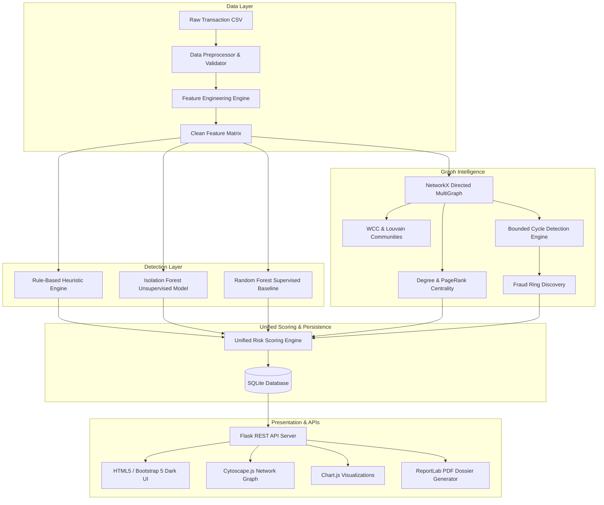
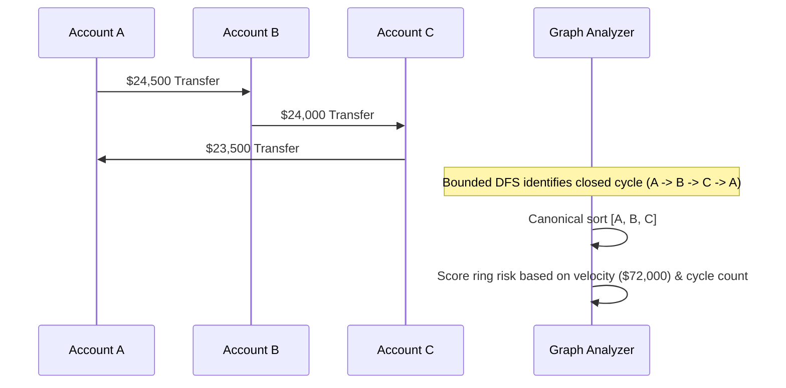
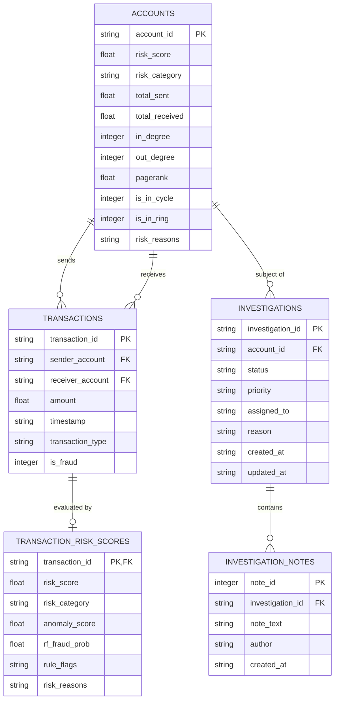

# System Architecture & Technical Design

This document details the software architecture, data pipelines, graph algorithms, and machine learning models powering **Graph-Based Fraud Intelligence**.

---

## 1. High-Level Architecture

The platform follows a modular, decoupled pipeline architecture separating synthetic generation, data preprocessing, graph topology analytics, hybrid risk scoring, and interactive visualization.

---

## 2. Component Breakdown

### A. Synthetic Data Generator (`src/generator.py`)
Produces realistic transactional workloads with controlled fraud typologies:
1. **Structuring / Smurfing**: Small sequential transfers just below the compliance threshold (\$8,500 - \$9,999).
2. **Velocity Bursts**: Multi-transaction bursts ($> 3$ transactions in $< 15$ minutes) indicating automated bot withdrawals.
3. **Circular Laundering**: Funds routed through closed cycles ($A \to B \to C \to A$) to obscure origin.
4. **Outlier Spikes**: Anomalous transaction values exceeding \$50,000.
5. **Fan-Out Schemes**: One high-balance account dispersing capital quickly across dozens of mule accounts.

### B. Feature Engineering & Preprocessing (`src/detector.py`)
- **No Label Leakage**: Feature computation excludes the `is_fraud` label to prevent data contamination.
- **Log Amount**: $\ln(1 + \text{amount})$ to compress long-tailed monetary values.
- **Rolling Window Optimization**: Employs `numpy.searchsorted` to achieve $O(N \log N)$ rolling 1-hour and 24-hour velocity calculations rather than naive $O(N^2)$ pairwise timestamp comparisons.
- **Deviation from Mean**: Compares current amount against the sender's cumulative running mean.

### C. Graph Analysis & Ring Detection (`src/graph_analyzer.py`)
- **Directed Graph Representation**: Bank accounts are nodes; financial transfers are directed weighted edges.
- **Centrality Metrics**:
  - *In-Degree / Out-Degree*: Identifies fund aggregation sinks and distribution hubs.
  - *PageRank*: Calculates structural centrality and recursive money transit importance ($\alpha = 0.85$).
- **Community Detection**: Weakly Connected Components (WCC) isolate disconnected account clusters; Louvain partitioning discovers dense transaction subgraphs.
- **Depth-Bounded Cycle Search**:
  - *Problem*: Standard Johnson's algorithm ($O((V + E)(C + 1))$) explodes exponentially on dense financial graphs.
  - *Solution*: A depth-bounded DFS exploring paths up to length $k \le 4$.
  - *Canonical Minimum-Index Root*: Ensures that cycle $(A \to B \to C \to A)$ is visited only when starting from $\min(A, B, C)$, eliminating duplicate cyclic permutations in under 3 milliseconds.

---

## 3. Unified Risk Scoring Framework (`src/risk_scorer.py`)

The platform synthesizes five orthogonal signals into an explainable score between 0 and 100:

$$\text{Risk Score} = 0.20 \cdot S_{\text{rule}} + 0.15 \cdot S_{\text{iso}} + 0.25 \cdot S_{\text{rf}} + 0.20 \cdot S_{\text{centrality}} + 0.20 \cdot S_{\text{ring}}$$

| Component | Weight | Source | Description |
|---|---|---|---|
| Rule Violations | 20% | Rule-Based Engine | Threshold violations (structuring, velocity, amount spikes). |
| Isolation Forest | 15% | Unsupervised Model | Statistical feature space outlier score. |
| Random Forest | 25% | Supervised Model | Probabilistic fraud classification score. |
| Graph Centrality | 20% | NetworkX | Normalized in/out degree and PageRank centrality. |
| Ring Topology | 20% | Bounded DFS | Direct membership in circular laundering chains or rings. |

### Risk Tiers
- **Low Risk (0–29)**: Standard retail banking activity.
- **Medium Risk (30–59)**: Moderate deviations or single low-confidence rule trigger.
- **High Risk (60–84)**: Coordinated patterns, repeated rule failures, or high model confidence.
- **Critical Risk (85–100)**: Active membership in circular laundering rings with high velocity.

---

## 4. Database Schema

The persistence layer uses SQLite with enforced foreign key integrity:

---

## 5. Security & Audit Principles

1. **Deterministic Reproducibility**: All synthetic generations and model splits utilize fixed random seeds (`RANDOM_SEED = 42`).
2. **Environment Isolation**: Application settings and database URLs are isolated via environment variables (`.env`).
3. **No Unsanitized Inputs**: SQLite queries use parameter binding (`?`) to prevent SQL injection vulnerabilities.
4. **Audit Immutability**: Investigation logs record immutable timestamps for each status update and note appended by analysts.
5. **Dossier Accountability**: PDF export generation bundles case notes, counterparty lists, and forensic sign-off boxes suitable for compliance reviews.
