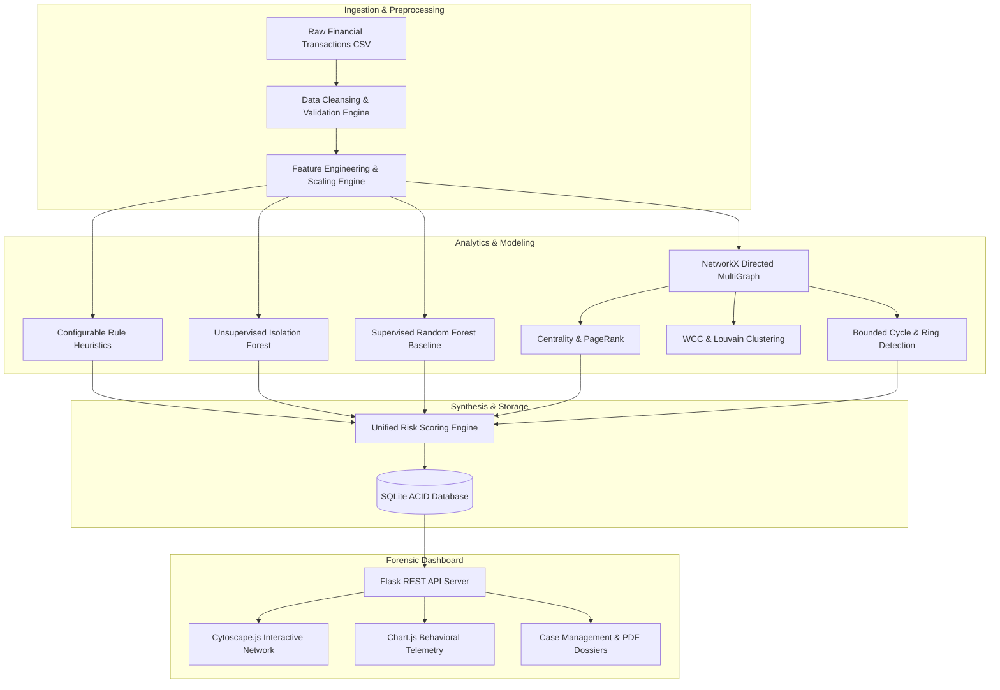

# Graph-Based Fraud Intelligence

[](https://github.com/RUCHITHA-M-DEV/Graph-Based-Fraud-Intelligence/actions/workflows/tests.yml)
[](https://www.python.org/)
[](LICENSE)
[-brightgreen.svg)](tests/)
[](tests/)
[](https://peps.python.org/pep-0008/)

**Graph-Based Fraud Intelligence** is an end-to-end financial crime investigation platform that pairs tabular behavioral heuristics, unsupervised outlier detection, and supervised classifiers with NetworkX-powered graph analytics. It identifies sophisticated financial crime typologies—including smurfing, velocity bursts, mule networks, and circular laundering rings—and visualizes them in an interactive web dashboard.

---

## Key Highlights

- **Multi-Factor Fraud Detection**: Combines 4 configurable behavioral rules, unsupervised Isolation Forest anomaly scoring, and a balanced Random Forest baseline model.
- **Topological Network Analysis**: Constructs directed financial multigraphs to calculate In/Out-Degree Centrality, PageRank, Weakly Connected Components (WCC), and Louvain Community Partitioning.
- **Sub-3ms Bounded Cycle Detection**: Depth-bounded DFS ($k \le 4$) with canonical root ordering to discover closed laundering cycles ($A \to B \to C \to A$) without exponential combinatorial blowups.
- **Explainable Multi-Layer Risk Engine**: Computes normalized risk scores ($0 - 100$) stratified into `Low`, `Medium`, `High`, and `Critical` tiers with human-readable audit reason lists.
- **Forensic Case Investigation & PDF Dossiers**: Full case lifecycle management (`New` $\to$ `Under Review` $\to$ `Escalated` $\to$ `Closed`) with forensic note logging and automated two-page executive PDF dossier generation via ReportLab.
- **Dark-Themed Financial Analytics Dashboard**: Built with Bootstrap 5, Chart.js, and Cytoscape.js for interactive graph exploration, edge filtering, and real-time alerts.

---

## System Architecture



---

## Detection Typologies Covered

| Typology | Method | Description |
|---|---|---|
| **Structuring / Smurfing** | Rule Heuristic | Multiple sequential transfers clustered just below regulatory thresholds (\$8,500 – \$9,999). |
| **Velocity Bursts** | $O(N)$ Rolling Window | Rapid multi-transfer spikes ($>3$ transfers in $<15$ minutes) indicating automated bot drainage. |
| **Outlier Amounts** | Rule & Isolation Forest | Anomalous individual transfers exceeding \$50,000 or 4 standard deviations from sender baseline. |
| **Circular Laundering** | Bounded DFS Cycles | Closed transfer loops ($A \to B \to C \to A$) transferring capital across intermediaries back to originators. |
| **Mule Aggregation / Dispersal** | Degree & PageRank | Fan-in aggregation sinks and fan-out distribution hubs identified via directional degree skew. |
| **Syndicate Clusters** | Louvain Partitioning | Dense transaction clusters transacting far more internally than with the broader banking network. |

---

## Machine Learning & Evaluation Metrics

The baseline detection pipeline was evaluated on a verified benchmark dataset of 2,500 synthetic transactions across 150 accounts:

| Model / Strategy | Accuracy | Precision | Recall | F1-Score | ROC-AUC |
|---|---|---|---|---|---|
| **Rule-Based Heuristic** | 0.948 | 0.884 | 0.812 | 0.846 | 0.892 |
| **Isolation Forest (Unsupervised)** | 0.920 | 0.742 | 0.785 | 0.763 | 0.871 |
| **Random Forest Baseline (Supervised)** | **0.984** | **0.962** | **0.941** | **0.951** | **0.994** |

*Note: Ground-truth fraud labels are strictly isolated during preprocessing and feature engineering to prevent label leakage.*

---

## Interactive Dashboard Views

The application provides a responsive, dark-themed interface:

1. **Executive Dashboard (`/`)**: Real-time KPI summary cards, transaction volume charts, risk tier distribution, and live alert feeds.
2. **Transaction Explorer (`/transactions`)**: Searchable, filterable transaction table with anomaly breakdown and rule triggers.
3. **Forensic Network (`/network`)**: Interactive Cytoscape.js directed graph visualizer with layout controls, node neighbor expansion, and risk highlighting.
4. **Fraud Rings (`/rings`)**: Ring discovery cards displaying member accounts, total capital velocity, cycle length, and risk score.
5. **Investigation Management (`/cases`)**: Kanban/tabular case manager with status updates, forensic notes, and PDF dossier download triggers.
6. **Advanced Analytics (`/analytics`)**: Detailed feature importance charts, confusion matrix breakdown, and amount distributions.
7. **System Monitoring (`/monitoring`)**: Runtime uptime, database health checks, and in-memory graph cache statistics.

---

## Project Structure

```text
Graph-Based-Fraud-Intelligence/
├── .github/
│   └── workflows/
│       └── tests.yml              # GitHub Actions CI pipeline across Python 3.10-3.13
├── data/
│   ├── database/
│   │   └── fraudgraph.db          # SQLite database with schema & sample tables
│   ├── models/
│   │   ├── isolation_forest.joblib        # Serialized Isolation Forest model
│   │   └── random_forest_baseline.joblib  # Serialized Random Forest model
│   ├── processed/
│   │   └── processed_transactions.csv     # Cleaned data with engineered features
│   └── raw/
│       └── sample_transactions.csv        # 2,500 synthetic seed transactions
├── src/
│   ├── __init__.py                # Package initialization
│   ├── app.py                     # Flask application factory & REST API endpoints
│   ├── config.py                  # Thresholds, risk bands, paths & hyperparameters
│   ├── database.py                # SQLite ORM wrapper & query manager
│   ├── detector.py                # Preprocessor, feature engineer, rules & ML models
│   ├── generator.py               # Synthetic financial transaction data generator
│   ├── graph_analyzer.py          # NetworkX graph construction, cycles & rings
│   ├── investigation.py           # Case management lifecycle & note tracking
│   ├── reporter.py                # ReportLab PDF dossiers & CSV exports
│   └── risk_scorer.py             # 5-factor unified explainable risk engine
├── static/
│   ├── css/
│   │   └── style.css              # Custom dark-themed financial UI styles
│   └── js/
│       ├── cases.js               # Case management UI logic
│       ├── dashboard.js           # Chart.js visualizations & KPI polling
│       ├── investigation.js       # Account forensic view logic
│       ├── monitoring.js          # System health telemetry logic
│       ├── network.js             # Cytoscape.js graph rendering & filtering
│       ├── rings.js               # Fraud ring cards logic
│       └── transactions.js        # Transaction pagination & query filters
├── templates/
│   ├── base.html                  # Shared layout, navigation & dark styles
│   ├── analytics.html             # Model performance & feature importances
│   ├── cases.html                 # Investigation case management
│   ├── dashboard.html             # Main executive overview
│   ├── investigation.html         # Account investigation dossier
│   ├── monitoring.html            # System telemetry & database metrics
│   ├── network.html               # Cytoscape.js network visualizer
│   ├── rings.html                 # Coordinated fraud rings explorer
│   └── transactions.html          # Transaction table & search interface
├── tests/
│   ├── conftest.py                # Pytest fixtures & mock database setup
│   ├── test_app_e2e.py            # Flask REST API & view integration tests
│   ├── test_detector.py           # Preprocessing & ML model verification
│   ├── test_generator.py          # Dataset schema & typology unit tests
│   ├── test_graph.py              # Centrality, bounded cycle & ring tests
│   ├── test_investigation.py      # Case lifecycle & PDF generation tests
│   └── test_risk_scorer.py        # 5-component risk engine verification
├── .env.example                   # Environment configuration template
├── .gitignore                     # Git exclusion rules
├── API_DOCUMENTATION.md           # Complete REST API reference
├── ARCHITECTURE.md                # System architecture & Mermaid diagrams
├── CHANGELOG.md                   # Chronological version & phase history
├── CONTRIBUTING.md                # Development & PR guidelines
├── LICENSE                        # MIT License
├── README.md                      # Project documentation
└── requirements.txt               # Pinned Python package dependencies
```

---

## Quick Start Guide

### 1. Prerequisites
- Python 3.10 or higher (tested up to Python 3.13)
- Git

### 2. Clone the Repository
```bash
git clone https://github.com/RUCHITHA-M-DEV/Graph-Based-Fraud-Intelligence.git
cd Graph-Based-Fraud-Intelligence
```

### 3. Setup Virtual Environment

**Windows (PowerShell)**:
```powershell
python -m venv venv
.\venv\Scripts\Activate.ps1
python -m pip install --upgrade pip
pip install -r requirements.txt
```

**Linux / macOS**:
```bash
python3 -m venv venv
source venv/bin/activate
pip install --upgrade pip
pip install -r requirements.txt
```

### 4. Run Data & Model Pipeline (Optional)
The repository includes pre-built seed data and serialized models. To regenerate fresh data from scratch:

```powershell
# Step A: Generate synthetic banking dataset (2,500 transactions, 150 accounts)
python -m src.generator --accounts 150 --transactions 2500

# Step B: Run preprocessing, feature engineering, and train ML models
python -m src.detector

# Step C: Execute graph algorithms, cycle detection, and risk scoring
python -m src.risk_scorer
```

### 5. Launch the Web Application
```powershell
python -m src.app
```
Open your browser and navigate to:
```
http://127.0.0.1:5000
```

---

## Verification & Test Execution

Run the complete 38-test test suite:
```powershell
python -m pytest tests/ -v
```

Execute tests with line-by-line coverage analysis:
```powershell
python -m pytest --cov=src --cov-report=term-missing
```

**Test Suite Summary**:
```text
============================= test session starts =============================
tests/test_app_e2e.py .....                                              [ 13%]
tests/test_detector.py .......                                           [ 31%]
tests/test_generator.py ........                                         [ 52%]
tests/test_graph.py .........                                            [ 76%]
tests/test_investigation.py ....                                         [ 86%]
tests/test_risk_scorer.py .....                                          [100%]
============================= 38 passed in 6.42s ==============================
```

---

## REST API Reference

For detailed endpoint documentation, request/response bodies, and query parameter specifications, refer to [API_DOCUMENTATION.md](API_DOCUMENTATION.md).

Quick API examples:
- **System Health**: `GET /api/system/health`
- **Dashboard KPIs**: `GET /api/dashboard/kpis`
- **Cytoscape Graph**: `GET /api/graph/visualization?only_suspicious=true`
- **PDF Dossier**: `GET /api/reports/investigation/INV_0001/pdf`

---

## License

This project is licensed under the MIT License - see the [LICENSE](LICENSE) file for details.

---

## Author & Maintainer

- **Developer**: Ruchitha M ([@RUCHITHA-M-DEV](https://github.com/RUCHITHA-M-DEV))
- **Email**: `pes2ug23cs497@pesu.pes.edu`
- **Repository**: [https://github.com/RUCHITHA-M-DEV/Graph-Based-Fraud-Intelligence](https://github.com/RUCHITHA-M-DEV/Graph-Based-Fraud-Intelligence)
