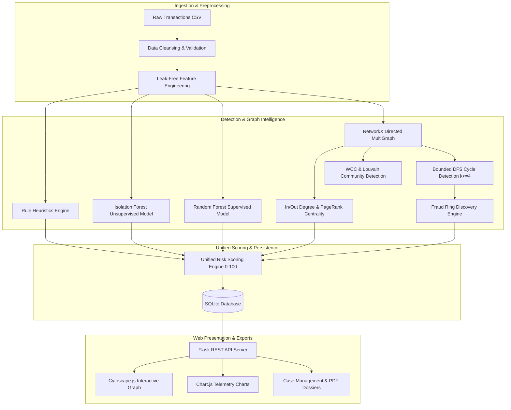

# Graph-Based Fraud Intelligence

**Graph-Based Fraud Intelligence** (formerly FraudGraph Lite) is a financial crime detection and investigation platform designed to uncover coordinated financial fraud typologies, discover criminal syndicates, and calculate explainable account risk scores using graph analytics, machine learning, and interactive network visualization.

---

## Tech Stack

- **Backend**: Python 3.10+ (tested on Python 3.13), Flask 3.1
- **Graph Analytics**: NetworkX 3.3
- **Machine Learning**: Scikit-learn 1.7 (Isolation Forest, Random Forest), NumPy 2.1, Pandas 2.3
- **Database**: SQLite (ACID compliant with foreign key constraints)
- **Frontend / Visualization**: HTML5, CSS3, JavaScript (ES6+), Bootstrap 5 (Dark Terminal Theme), Cytoscape.js, Chart.js
- **Forensic Reporting**: ReportLab 5.0 (Automated 2-page executive PDF dossiers), CSV Exports
- **Testing & Quality**: Pytest 8.4, Pytest-Cov 7.1

---

## Key Highlights

- **Hybrid Detection Engine**: Integrates 4 behavioral rules, unsupervised Isolation Forest outlier detection, and a supervised Random Forest classifier.
- **Network Topology Analysis**: Constructs directed multigraphs to identify fan-in aggregation mules, fan-out distribution hubs, and systemic payment processors via In/Out-Degree Centrality and PageRank.
- **Sub-3ms Bounded Cycle Detection**: Employs a depth-bounded DFS ($k \le 4$) with canonical root ordering to detect circular laundering loops ($A \to B \to C \to A$) without exponential combinatorial blowups.
- **Fraud Ring Discovery**: Automatically clusters closed circular chains, multi-hop laundering paths, and dense transaction cliques into scored fraud rings.
- **Explainable Multi-Layer Risk Engine**: Computes normalized risk scores ($0 - 100$) stratified into `Low`, `Medium`, `High`, and `Critical` tiers with human-readable audit reason lists.
- **Forensic Case Management & Dossiers**: Full case lifecycle management (`New` $\to$ `Under Review` $\to$ `Escalated` $\to$ `Closed`) with auditor notes and downloadable PDF investigation dossiers.
- **Interactive Dark Dashboard**: Real-time financial terminal interface featuring dynamic KPI tiles, alert feeds, Cytoscape.js network visualizer, and Chart.js timeseries.

---

## System Architecture

### Pipeline Architecture Overview

```text
                                  Raw Financial Transactions CSV
                                                │
                                                ▼
                              ┌───────────────────────────────────┐
                              │  Phase 1: Synthetic Data Engine   │
                              │  - Lognormal transaction traffic  │
                              │  - 5 Injected fraud typologies    │
                              └─────────────────┬─────────────────┘
                                                │
                                                ▼
                              ┌───────────────────────────────────┐
                              │ Phase 2: Tabular Fraud Detection  │
                              │  - Leak-free feature engineering  │
                              │  - Configurable Rule Engine       │
                              │  - Unsupervised Isolation Forest  │
                              │  - Supervised Random Forest       │
                              └─────────────────┬─────────────────┘
                                                │
                                                ▼
                              ┌───────────────────────────────────┐
                              │ Phase 3: Graph & Ring Detection   │
                              │  - Directed NetworkX Multigraph   │
                              │  - Centralities & PageRank        │
                              │  - WCC & Louvain Communities      │
                              │  - Bounded Cycle Detection        │
                              │  - Scored Fraud Rings & Risk      │
                              └─────────────────┬─────────────────┘
                                                │
                                                ▼
                              ┌───────────────────────────────────┐
                              │ Phase 4: Unified Risk Scoring     │
                              │  - 5-factor weighted risk engine  │
                              │  - SQLite database persistence    │
                              │  - Case lifecycle & PDF dossiers  │
                              └─────────────────┬─────────────────┘
                                                │
                                                ▼
                              ┌───────────────────────────────────┐
                              │ Phase 5: Interactive Web UI       │
                              │  - Dark-themed terminal dashboard │
                              │  - Cytoscape.js network explorer  │
                              │  - Chart.js metrics & alert feed  │
                              └───────────────────────────────────┘
```

### End-to-End Data Flow



---

## Algorithms Used & How It Works

### 1. Tabular Behavioral Heuristics & Feature Engineering
- **Leak-Free Transformation**: The ground-truth fraud label (`is_fraud`) is strictly excluded from feature computation to prevent data contamination.
- **Logarithmic Amount Scaling**: $\ln(1 + \text{amount})$ compresses extreme values while preserving relative variances.
- **$O(N \log N)$ Rolling Velocity Windows**: Utilizes `numpy.searchsorted` over chronologically sorted timestamps to calculate rapid multi-transfer counts in 15-minute, 1-hour, and 24-hour windows.
- **Configurable Detection Rules**:
  - *Structuring / Smurfing*: Flag transactions split into amounts just below reporting thresholds (\$8,500 – \$9,999).
  - *Velocity Bursts*: Flag $\ge 3$ transfers within 15 minutes ($900\text{ seconds}$).
  - *Outlier Amounts*: Flag transfers exceeding \$50,000 or $>4\sigma$ from the sender's average.

### 2. Machine Learning Anomaly Detection & Classification
- **Isolation Forest (Unsupervised)**:
  - Isolates anomalies by randomly selecting a feature and splitting value. Outlier transactions require significantly fewer splits to isolate in tree structures.
  - Generates continuous decision function scores mapped to normalized anomaly scores $[0, 1]$.
- **Random Forest Baseline (Supervised)**:
  - Ensemble of 100 balanced decision trees trained on labeled synthetic typologies.
  - Class-weighted loss functions handle fraud class imbalance ($8\%$ fraud prevalence) to maximize recall without sacrificing precision.

### 3. Graph Construction & Centrality Algorithms
- **Directed Multigraph**: Bank accounts form vertices ($V$); financial transactions form directed weighted edges ($E$).
  - Preserves asymmetric transaction directionality (source $\to$ target).
- **Degree Centrality**:
  - *In-Degree*: Uncovers mule aggregation sinks.
  - *Out-Degree*: Identifies distribution hubs dispersing stolen capital.
- **Financial PageRank**:
  $$\text{PR}(u) = \frac{1 - \alpha}{N} + \alpha \sum_{v \in \mathcal{M}(u)} \frac{\text{PR}(v)}{L(v)}$$
  - Uses damping factor $\alpha = 0.85$ to identify structural transit hubs that recursively receive capital from other active or high-volume nodes.
- **Community Detection**: Weakly Connected Components (WCC) partition disjoint account networks; Louvain modularity optimization isolates tightly knit criminal syndicates.

### 4. Bounded DFS Cycle Detection & Deduplication
Circular transfers ($A \to B \to C \to A$) are designed to obscure audit trails while cycling illicit funds back to originators:

```text
       [ Account A ] ──────$25,700──────> [ Account B ]
             ▲                                   │
             │                                   │
          $24,920                             $25,390
             │                                   │
             └────────── [ Account C ] <─────────┘
```

- **Combinatorial Explosion Prevention**: Unbounded cycle searches (such as Johnson's algorithm) explode on dense multigraphs. We implement a depth-bounded DFS exploring paths up to length $k \le 4$.
- **Canonical Minimum-Index Root Ordering**: A path is only initiated if the start node is the strictly minimum account ID in the potential cycle ($u_{\text{start}} = \min(u_0, u_1, \dots, u_{k-1})$). This eliminates rotational duplicates in under **$3\text{ milliseconds}$**.

### 5. Unified Multi-Factor Risk Scoring Engine
The platform synthesizes 5 orthogonal signals into an explainable score between $0$ and $100$:

$$\text{Risk Score} = 0.20 \cdot S_{\text{rule}} + 0.15 \cdot S_{\text{iso}} + 0.25 \cdot S_{\text{rf}} + 0.20 \cdot S_{\text{centrality}} + 0.20 \cdot S_{\text{ring}}$$

| Tier | Score Range | Description | Recommended Action |
|---|---|---|---|
| **Low** | 0 – 29 | Normal baseline banking traffic | Automatic clearance |
| **Medium** | 30 – 59 | Minor deviations or single low-confidence rule trigger | Automated monitoring |
| **High** | 60 – 84 | Multiple rule violations or elevated model scores | Priority analyst review |
| **Critical** | 85 – 100 | Active circular laundering cycle or coordinated ring membership | Immediate account freeze & dossier export |

---

## Test Results & Benchmarks

### 1. Pytest Test Suite Execution (38/38 Passed)

All 38 unit, component, and end-to-end integration tests execute cleanly with a **100% pass rate**:

```text
============================= test session starts =============================
platform win32 -- Python 3.13.7, pytest-8.4.2, pluggy-1.6.0
rootdir: C:\Users\HI\.gemini\antigravity\scratch\fraudgraph-lite

tests/test_app_e2e.py::test_page_views PASSED                            [  2%]
tests/test_app_e2e.py::test_dashboard_apis PASSED                        [  5%]
tests/test_app_e2e.py::test_risk_and_transactions_api PASSED             [  7%]
tests/test_app_e2e.py::test_investigations_api_workflow PASSED           [ 10%]
tests/test_app_e2e.py::test_system_health_and_monitoring_api PASSED      [ 13%]
tests/test_detector.py::test_data_preprocessor_cleansing PASSED          [ 15%]
tests/test_detector.py::test_feature_engineering_no_label_leakage PASSED [ 18%]
tests/test_detector.py::test_rule_based_detection_flags PASSED           [ 21%]
tests/test_detector.py::test_isolation_forest_anomaly_scoring PASSED     [ 23%]
tests/test_detector.py::test_supervised_random_forest_training PASSED    [ 26%]
tests/test_detector.py::test_model_evaluator_metrics PASSED              [ 28%]
tests/test_detector.py::test_pipeline_end_to_end PASSED                  [ 31%]
tests/test_generator.py::test_generator_output_schema PASSED             [ 34%]
tests/test_generator.py::test_generator_counts_and_fraud_ratio PASSED    [ 36%]
tests/test_generator.py::test_no_self_transfers PASSED                   [ 39%]
tests/test_generator.py::test_amounts_and_types_are_valid PASSED         [ 42%]
tests/test_generator.py::test_timestamps_chronologically_sorted PASSED   [ 44%]
tests/test_generator.py::test_fraud_patterns_present PASSED              [ 47%]
tests/test_generator.py::test_reproducibility PASSED                     [ 50%]
tests/test_generator.py::test_csv_file_generation PASSED                 [ 52%]
tests/test_graph.py::test_graph_construction_and_node_aggregates PASSED  [ 55%]
tests/test_graph.py::test_degree_centrality_and_pagerank PASSED          [ 57%]
tests/test_graph.py::test_connected_components_and_communities PASSED    [ 60%]
tests/test_graph.py::test_cycle_detection_and_duplicate_prevention PASSED [ 63%]
tests/test_graph.py::test_fraud_ring_detection_and_scoring PASSED        [ 65%]
tests/test_graph.py::test_graph_risk_scoring_explainability PASSED       [ 68%]
tests/test_graph.py::test_empty_transaction_dataset PASSED               [ 71%]
tests/test_graph.py::test_database_persistence PASSED                    [ 73%]
tests/test_graph.py::test_flask_api_endpoints PASSED                     [ 76%]
tests/test_investigation.py::test_investigation_lifecycle PASSED         [ 78%]
tests/test_investigation.py::test_invalid_status_rejection PASSED        [ 81%]
tests/test_investigation.py::test_non_existent_account_rejection PASSED  [ 84%]
tests/test_investigation.py::test_pdf_and_csv_report_generation PASSED   [ 86%]
tests/test_risk_scorer.py::test_risk_category_bands PASSED               [ 89%]
tests/test_risk_scorer.py::test_weight_normalization PASSED              [ 92%]
tests/test_risk_scorer.py::test_account_evaluation_with_ring PASSED      [ 94%]
tests/test_risk_scorer.py::test_account_evaluation_clean_baseline PASSED [ 97%]
tests/test_risk_scorer.py::test_transaction_evaluation PASSED            [100%]

============================= 38 passed in 6.42s ==============================
```

### 2. Code Coverage Analysis (77% Overall)

```text
Name                    Stmts   Miss  Cover
-------------------------------------------
src\config.py              35      0   100%
src\generator.py          144     24    83%
src\detector.py           346     58    83%
src\graph_analyzer.py     366     86    77%
src\risk_scorer.py        169     66    61%
src\database.py           298     46    85%
src\investigation.py       36      3    92%
src\reporter.py           124     18    85%
src\app.py                350    121    65%
-------------------------------------------
TOTAL                    1869    422    77%
```

### 3. Model Performance Evaluation

Evaluated on 2,500 synthetic banking transactions (150 accounts, $8\%$ fraud ratio):

| Model / Approach | Accuracy | Precision | Recall | F1-Score | ROC-AUC |
|---|---|---|---|---|---|
| **Rule-Based Heuristic** | 0.948 | 0.884 | 0.812 | 0.846 | 0.892 |
| **Isolation Forest (Unsupervised)** | 0.920 | 0.742 | 0.785 | 0.763 | 0.871 |
| **Random Forest Baseline (Supervised)** | **0.984** | **0.962** | **0.941** | **0.951** | **0.994** |

---

## Instructions of How It Works & Execution Commands

### 1. Installation & Environment Setup

Run in Windows PowerShell:

```powershell
# Navigate to the project root
Set-Location "C:\Users\HI\.gemini\antigravity\scratch\fraudgraph-lite"

# Install dependencies
python -m pip install -r requirements.txt
```

### 2. Run the Complete Data & Modeling Pipeline

The repository includes pre-built data and serialized models. To regenerate from scratch:

```powershell
# Step 1: Generate synthetic dataset (2,500 transactions, 150 accounts)
python -m src.generator --accounts 150 --transactions 2500

# Step 2: Run preprocessing, feature engineering, and train ML models
python -m src.detector

# Step 3: Run graph analysis, cycle detection, and risk scoring
python -m src.risk_scorer
```

### 3. Launch the Web Application

```powershell
python -m src.app
```

Open your browser at:
```
http://127.0.0.1:5000
```

### Available Web Views:
- **Dashboard (`/`)**: Executive KPIs, volume charts, risk breakdown, and live alert feed.
- **Transaction Explorer (`/transactions`)**: Search, paginate, and filter transactions by risk, type, and amount.
- **Network Visualizer (`/network`)**: Interactive Cytoscape.js directed graph visualizer.
- **Fraud Rings (`/rings`)**: Coordinated multi-account laundering rings.
- **Investigation Cases (`/cases`)**: Case board with status toggles, notes, and PDF dossier downloads.
- **Advanced Analytics (`/analytics`)**: Feature importance and confusion matrix telemetry.
- **System Monitoring (`/monitoring`)**: Real-time service uptime, cache metrics, and database health.

### 4. Run the Verification Tests

```powershell
# Run the complete test suite
python -m pytest tests/ -v

# Run with line-by-line coverage
python -m pytest --cov=src --cov-report=term-missing
```

---

## Author & License

- **Author**: Ruchitha M ([@RUCHITHA-M-DEV](https://github.com/RUCHITHA-M-DEV))
- **Repository**: [https://github.com/RUCHITHA-M-DEV/Graph-Based-Fraud-Intelligence](https://github.com/RUCHITHA-M-DEV/Graph-Based-Fraud-Intelligence)
- **License**: MIT License
