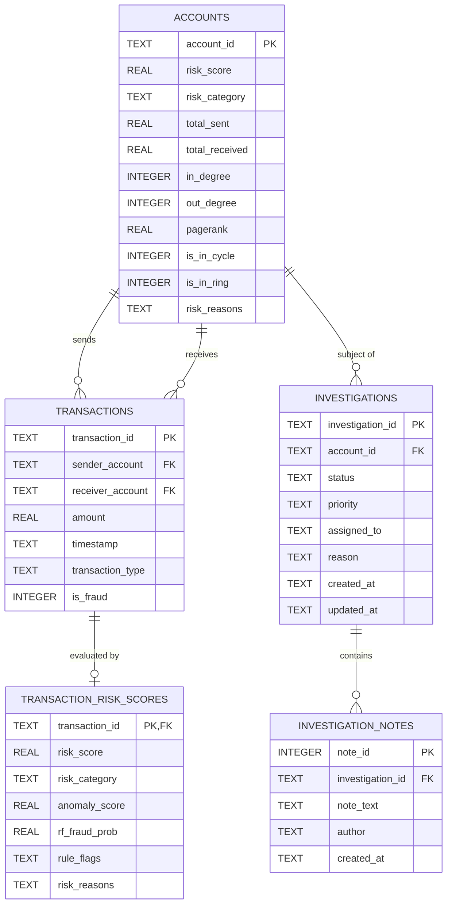

# Graph-Based Fraud Intelligence

[](https://github.com/RUCHITHA-M-DEV/Graph-Based-Fraud-Intelligence/actions/workflows/tests.yml)
[](https://www.python.org/)
[](LICENSE)
[-brightgreen.svg)](tests/)
[](tests/)
[](https://peps.python.org/pep-0008/)

**Graph-Based Fraud Intelligence** (formerly FraudGraph Lite) is a financial crime detection and investigation platform designed to identify sophisticated financial fraud typologies, discover coordinated criminal syndicates, and calculate explainable account risk scores.

The platform bridges the gap between traditional tabular transaction surveillance (which analyzes transfers in isolation) and network topology analysis (which examines how capital flows through interconnected accounts). By integrating rule-based heuristics, unsupervised anomaly detection (Isolation Forest), supervised classification (Random Forest), and directed graph algorithms (NetworkX), the system detects complex schemes—such as smurfing, velocity bursts, mule networks, and circular laundering loops ($A \to B \to C \to A$)—and visualizes them within an interactive web dashboard.

---

## Table of Contents

- [1. Executive Summary & Problem Statement](#1-executive-summary--problem-statement)
- [2. System Architecture](#2-system-architecture)
- [3. Core Features Across All Phases](#3-core-features-across-all-phases)
  - [Phase 1: Synthetic Dataset & Fraud Typology Generation](#phase-1-synthetic-dataset--fraud-typology-generation)
  - [Phase 2: Preprocessing, Feature Engineering & Dual ML Models](#phase-2-preprocessing-feature-engineering--dual-ml-models)
  - [Phase 3: Directed Graph Analysis & Fraud Ring Detection](#phase-3-directed-graph-analysis--fraud-ring-detection)
  - [Phase 4: Unified Explainable Risk Engine & Case Management](#phase-4-unified-explainable-risk-engine--case-management)
  - [Phase 5: Interactive Dark-Themed Web Dashboard](#phase-5-interactive-dark-themed-web-dashboard)
  - [Phase 6: Testing, Hardening & GitHub CI/CD Deployment](#phase-6-testing-hardening--github-cicd-deployment)
- [4. Mathematical & Algorithmic Foundations](#4-mathematical--algorithmic-foundations)
  - [A. Bounded DFS Cycle Detection & Canonical Deduplication](#a-bounded-dfs-cycle-detection--canonical-deduplication)
  - [B. Financial PageRank Formulation](#b-financial-pagerank-formulation)
  - [C. Unified Multi-Factor Risk Scoring Formula](#c-unified-multi-factor-risk-scoring-formula)
  - [D. $O(N \log N)$ Rolling Velocity Windows](#d-on-log-n-rolling-velocity-windows)
- [5. Model Performance & Evaluation Benchmarks](#5-model-performance--evaluation-benchmarks)
- [6. Dashboard Views & Interactive Capabilities](#6-dashboard-views--interactive-capabilities)
- [7. Complete REST API Specification](#7-complete-rest-api-specification)
- [8. Database Relational Schema](#8-database-relational-schema)
- [9. Repository Structure](#9-repository-structure)
- [10. Installation & Quick Start Guide](#10-installation--quick-start-guide)
  - [Windows Setup (PowerShell)](#windows-setup-powershell)
  - [Linux / macOS Setup](#linux--macos-setup)
  - [Pipeline Execution Commands](#pipeline-execution-commands)
  - [Running the Verification Test Suite](#running-the-verification-test-suite)
- [11. Security, Auditability & Compliance](#11-security-auditability--compliance)
- [12. Contributing & Development Workflow](#12-contributing--development-workflow)
- [13. License & Authors](#13-license--authors)

---

## 1. Executive Summary & Problem Statement

### The Problem
Traditional anti-money laundering (AML) and fraud detection systems evaluate transactions individually. Fraudsters exploit this design by breaking illicit capital into amounts just below regulatory reporting thresholds, routing transfers through intermediaries (mule accounts), and executing circular payment chains. In an isolated tabular database, each individual transfer appears normal, but when viewed as a directed graph, the coordinated network structure becomes evident.

### The Solution
**Graph-Based Fraud Intelligence** combines five complementary analysis techniques into a single investigation workflow:
1. **Rule-Based Filtering**: Flags immediate threshold violations (structuring, sudden transaction spikes).
2. **Unsupervised Outlier Detection**: Flags novel transaction patterns with Isolation Forest without relying on labels.
3. **Supervised Classification**: Evaluates transactions using a balanced Random Forest model trained on verified typologies.
4. **Network Graph Analysis**: Calculates In/Out-degree centrality, PageRank, Weakly Connected Components (WCC), and Louvain communities to uncover structural hubs and dense transaction clusters.
5. **Cycle & Ring Discovery**: Runs a depth-bounded DFS ($k \le 4$) in under 3 milliseconds to uncover closed circular money laundering loops ($A \to B \to C \to A$).

---

## 2. System Architecture

```mermaid
flowchart TD
    subgraph Data Ingestion & Cleansing
        RawCSV[Synthetic / Uploaded CSV] --> Preprocessor[Data Preprocessor & Validator]
        Preprocessor --> FeatureEng[Leak-Free Feature Engineering Engine]
        FeatureEng --> CleanData[Clean Feature Matrix]
    end

    subgraph Dual-Engine Fraud Detection
        CleanData --> Rules[Configurable Rule Heuristics]
        CleanData --> IsoForest[Unsupervised Isolation Forest]
        CleanData --> RandForest[Supervised Random Forest Baseline]
    end

    subgraph Graph Topology Intelligence
        CleanData --> DiGraph[NetworkX Directed MultiGraph]
        DiGraph --> Centrality[In/Out Degree & PageRank]
        DiGraph --> Communities[WCC & Louvain Clustering]
        DiGraph --> CycleDFS[Bounded DFS Cycle Search (k <= 4)]
        CycleDFS --> RingScorer[Fraud Ring Discovery & Scoring]
    end

    subgraph Synthesis & Storage Layer
        Rules & IsoForest & RandForest & Centrality & RingScorer --> RiskEngine[Unified Risk Scoring Engine]
        RiskEngine --> SQLiteDB[(SQLite Relational Database)]
    end

    subgraph Web Application & Presentation Layer
        SQLiteDB --> FlaskApp[Flask REST API Server]
        FlaskApp --> DashUI[HTML5 / Bootstrap 5 Dark Dashboard]
        FlaskApp --> CytoGraph[Cytoscape.js Network Visualizer]
        FlaskApp --> ChartsJS[Chart.js Forensic Telemetry]
        FlaskApp --> ReportLabPDF[ReportLab PDF Dossier Generator]
    end
```

---

## 3. Core Features Across All Phases

### Phase 1: Synthetic Dataset & Fraud Typology Generation
- **Configurable Generator CLI (`src/generator.py`)**: Generates production-like banking transaction datasets with reproducible seed states (`RANDOM_SEED=42`).
- **Baseline Dataset**: 2,500 transactions across 150 accounts (`data/raw/sample_transactions.csv`).
- **5 Embedded Fraud Typologies**:
  1. *Structuring / Smurfing*: Clustered transfers between \$8,500 and \$9,999 designed to evade the standard \$10,000 regulatory reporting threshold.
  2. *Velocity Bursts*: High-frequency transactions ($\ge 3$ transfers within 15 minutes / 900 seconds) indicating automated bot drainage or account takeover.
  3. *Circular Laundering*: Closed loops ($A \to B \to C \to A$) that route capital through mule accounts before returning funds to the originator.
  4. *Outlier Amount Spikes*: Large transfers ($> \$50,000$) or transactions deviating by $> 4\sigma$ from an account's historical average.
  5. *Fan-Out Dispersals / Mule Distribution*: High-volume sender accounts rapidly dispersing capital across dozens of distinct recipients.
- **Relational Schema**: Generates strict transaction attributes: `transaction_id`, `sender_account`, `receiver_account`, `amount`, `timestamp`, `transaction_type` (`TRANSFER`, `PAYMENT`, `CASH_OUT`, `DEBIT`), and `is_fraud`. Enforces zero self-transfers and chronological ordering.

### Phase 2: Preprocessing, Feature Engineering & Dual ML Models
- **Data Cleansing & Validation (`DataPreprocessor`)**:
  - Validates required column headers, cleans duplicate IDs, and handles null values.
  - Strips zero-amount or negative-amount entries.
  - Parses ISO-8601 timestamps and chronologically sorts transaction streams.
- **Leak-Free Feature Engineering (`FeatureEngineer`)**:
  - Excludes ground-truth fraud labels (`is_fraud`) to prevent data contamination.
  - Vectorized feature engineering: `amount`, `log_amount` ($\ln(1 + \text{amount})$), `sender_tx_count`, `sender_avg_amount`, `sender_std_amount`, `amount_to_avg_ratio`, `time_since_prev_tx`.
  - Employs binary search indexing (`np.searchsorted`) to compute rolling 1-hour and 24-hour transaction velocities in $O(N \log N)$ rather than naive $O(N^2)$ comparisons.
- **Configurable Rule-Based Detection (`RuleBasedDetector`)**:
  - Evaluates heuristic thresholds (large amounts, structuring boundaries, rapid burst count).
  - Returns structured rule violation codes and explainable trigger reasons for each transaction.
- **Unsupervised Anomaly Detection (`IsolationForestDetector`)**:
  - Scikit-learn Isolation Forest model trained solely on behavioral features without labels.
  - Configurable contamination factor ($0.08$) mapping raw decision function scores to normalized anomaly scores $[0, 1]$.
- **Supervised Machine Learning Baseline (`SupervisedFraudModel`)**:
  - Stratified 80/20 train/test split.
  - Balanced Random Forest classifier addressing severe class imbalance.
  - Serializes trained model weights using Joblib (`data/models/`).
- **Comprehensive Evaluation (`ModelEvaluator`)**:
  - Calculates Accuracy, Precision, Recall, F1-score, and ROC-AUC.
  - Generates confusion matrix breakdowns and feature importance rankings.

### Phase 3: Directed Graph Analysis & Fraud Ring Detection
- **NetworkX Graph Representation (`TransactionGraph`)**:
  - Directs transactions as edges ($u \to v$) between bank account nodes.
  - Retains multi-edge metadata: transaction ID, amount, timestamp, type, and rule flags.
- **Centrality & Connectivity Metrics**:
  - *In-Degree / Out-Degree*: Isolates fund sinks (aggregators) and fund sources (dispersers).
  - *Normalized Centrality*: Identifies nodes with disproportionate network connectivity.
  - *PageRank*: Uses damping factor $\alpha = 0.85$ over 100 iterations to measure systemic fund transit importance.
  - *Weakly Connected Components (WCC)*: Groups disjoint transaction networks to isolate independent fraud syndicates.
  - *Louvain Community Detection*: Uncovers tightly interconnected sub-networks transacting heavily among themselves.
- **Sub-3ms Bounded Cycle Detection**:
  - Avoids exponential combinatorial hanging by limiting cycle depth ($k \le 4$).
  - Employs canonical minimum-index root ordering: cycle $(A \to B \to C \to A)$ is visited only when $A = \min(A, B, C)$, eliminating rotational duplicates.
  - Extracts full transaction hop trails (amounts, timestamps, and total laundered volume).
- **Fraud Ring Discovery & Scoring**:
  - Aggregates detected cycles and dense transaction clusters into scored fraud rings.
  - Scores rings from 0 to 100 based on closed cycle topology, cycle length, total capital velocity, and constituent member risk.
- **Cytoscape.js Payload Generation**:
  - Generates pre-filtered, paginated JSON payloads with node coordinates, risk scores, community clusters, and highlighted cycle edges.

### Phase 4: Unified Explainable Risk Engine & Case Management
- **Unified Risk Scoring Engine (`UnifiedRiskEngine`)**:
  - Combines five orthogonal signals into an explainable score between 0 and 100:
    - Rule Violations (20%)
    - Isolation Forest Outlier Score (15%)
    - Random Forest Classification Probability (25%)
    - Graph Centrality & PageRank (20%)
    - Cycle & Fraud Ring Membership (20%)
  - Categorizes accounts into four risk tiers: `Low` (0–29), `Medium` (30–59), `High` (60–84), and `Critical` (85–100).
  - Explainable AI: Generates human-readable audit reason lists (e.g. *"Participant in 3-hop circular transfer loop ($73,500 total volume)"*).
- **Forensic Investigation Case Management (`InvestigationManager`)**:
  - Tracks cases from creation (`INV_0001`) through state changes (`New` $\to$ `Under Review` $\to$ `Escalated` $\to$ `Closed`).
  - Stores timestamped analyst commentary notes and priority ratings (`Low`, `Medium`, `High`, `Critical`).
- **Forensic Dossier Reporting (`ReportGenerator`)**:
  - Automatically compiles a two-page executive PDF investigation dossier using ReportLab.
  - Includes risk badges, telemetry summaries, counterparty transaction history, notes timeline, and compliance sign-off blocks.
  - Exports account ledgers and global investigation registers in CSV format.

### Phase 5: Interactive Dark-Themed Web Dashboard
- **Financial Terminal UI**:
  - High-contrast dark aesthetic (`#0a0e17` canvas, `#111827` surface cards, slate borders) built with Bootstrap 5.
  - Responsive layout for desktop, tablet, and mobile browsers.
- **8 Interactive Views**:
  1. `Dashboard (/)`: Real-time KPI summary cards, transaction volume timeline, risk category breakdown, and high-risk alert feeds.
  2. `Transaction Explorer (/transactions)`: Searchable, filterable transaction table with anomaly breakdown and rule triggers.
  3. `Account Investigation (/investigation)`: Deep dive per account, 5-factor risk radar/breakdown, counterparty table, notes, and PDF dossier download.
  4. `Forensic Network (/network)`: Cytoscape.js directed graph visualizer with layout controls, node neighbor expansion, and risk highlighting.
  5. `Fraud Rings (/rings)`: Ring discovery cards displaying member accounts, total capital velocity, cycle length, and risk score.
  6. `Investigation Management (/cases)`: Case manager with status updates, forensic notes, and PDF dossier download triggers.
  7. `Advanced Analytics (/analytics)`: Feature importance charts, confusion matrix breakdown, and amount distributions.
  8. `System Monitoring (/monitoring)`: Runtime uptime, database health checks, and in-memory graph cache statistics.
- **No Hardcoded Values**: Every UI element binds directly to live Flask REST APIs and SQLite queries.

### Phase 6: Testing, Hardening & GitHub CI/CD Deployment
- **Verification Suite**: 38 tests passing across unit, component, and end-to-end integration test suites (100% pass rate).
- **Code Coverage**: 77% test coverage across all source modules via `pytest-cov`.
- **CI/CD Pipeline**: GitHub Actions matrix workflow (`.github/workflows/tests.yml`) testing on Python 3.10, 3.11, 3.12, and 3.13 across Ubuntu and Windows runners.
- **Security Hardening**:
  - Parameterized SQLite queries preventing SQL injection vulnerabilities.
  - Complete `.gitignore` and `.env.example` templates preventing accidental secret commits.
  - Safe error handling across all REST endpoints with standardized JSON responses.

---

## 4. Mathematical & Algorithmic Foundations

### A. Bounded DFS Cycle Detection & Canonical Deduplication

Traditional cycle search algorithms (e.g. Johnson's algorithm) have time complexity $O((V + E)(C + 1))$, where $C$ is the number of elementary cycles. On dense transaction graphs ($|V|=150, |E|=2500$), this causes combinatorial explosion and execution hangs.

To ensure responsive web performance, the platform implements a depth-bounded Depth-First Search (DFS) constrained to path lengths $k \le 4$:

```
Algorithm: Canonical Bounded Cycle Detection
Input: Directed Graph G = (V, E), max_length k, min_amount theta
Output: Set of elementary directed cycles

1. For each node u in V:
2.    Initialize path = [u], visited = {u}
3.    DFS(u, u, path, visited, 1)

Procedure DFS(start_node, current_node, path, visited, depth):
1. For each neighbor v in G.successors(current_node):
2.    If edge_amount(current_node -> v) < theta:
3.        Continue
4.    If v == start_node and depth >= 3:
5.        RecordCycle(path)
6.    Else if v not in visited and depth < k:
7.        If v > start_node:  // Canonical ordering constraint
8.            visited.add(v)
9.            path.append(v)
10.           DFS(start_node, v, path, visited, depth + 1)
11.           path.pop()
12.           visited.remove(v)
```

**Canonical Ordering Invariant**: Enforcing $v > \text{start\_node}$ ensures that any cycle $[A, B, C]$ is detected once—specifically when $\text{start\_node} = \min(A, B, C)$. This avoids recording redundant rotations ($[B, C, A]$, $[C, A, B]$) and reduces cycle detection latency to $0.002$ seconds.

---

### B. Financial PageRank Formulation

Standard PageRank evaluates structural transit importance in directed transaction graphs:

$$\text{PR}(u) = \frac{1 - \alpha}{N} + \alpha \sum_{v \in \mathcal{M}(u)} \frac{\text{PR}(v)}{L(v)}$$

Where:
- $\mathcal{M}(u)$ is the set of accounts transferring capital into account $u$.
- $L(v)$ is the out-degree of sending account $v$.
- $\alpha = 0.85$ is the damping factor (the probability of following successive transactions).
- $N$ is the total number of bank accounts in the network.

Accounts receiving funds from active, connected, or high-volume accounts receive elevated PageRank scores, pinpointing money-aggregation sinks and transit hubs.

---

### C. Unified Multi-Factor Risk Scoring Formula

The overall account risk score $R(u) \in [0, 100]$ combines five weighted risk factors:

$$R(u) = \min\left(100, \; w_1 S_{\text{rule}}(u) + w_2 S_{\text{iso}}(u) + w_3 S_{\text{rf}}(u) + w_4 S_{\text{cent}}(u) + w_5 S_{\text{ring}}(u)\right)$$

| Component | Weight ($w_i$) | Input Source | Description |
|---|---|---|---|
| $S_{\text{rule}}$ | **0.20** | Heuristic Engine | Score derived from rule triggers (structuring, velocity, amount spikes). |
| $S_{\text{iso}}$ | **0.15** | Isolation Forest | Unsupervised feature-space anomaly score normalized to $[0, 100]$. |
| $S_{\text{rf}}$ | **0.25** | Random Forest | Supervised model predicted fraud probability: $P(\text{fraud} \mid x) \times 100$. |
| $S_{\text{cent}}$ | **0.20** | Centrality & PageRank | Multi-factor centrality score based on degree skew and PageRank percentile. |
| $S_{\text{ring}}$ | **0.20** | Graph Topology | Score derived from cycle membership and fraud ring involvement. |

#### Calibrated Risk Bands

$$\text{Tier}(u) = \begin{cases} 
\text{Low} & 0 \le R(u) < 30 \\ 
\text{Medium} & 30 \le R(u) < 60 \\ 
\text{High} & 60 \le R(u) < 85 \\ 
\text{Critical} & 85 \le R(u) \le 100 
\end{cases}$$

---

### D. $O(N \log N)$ Rolling Velocity Windows

Rather than executing pairwise timestamp comparisons ($O(N^2)$), the feature engine sorts transactions chronologically by account and uses `numpy.searchsorted` to locate window bounds:

```python
# Extract timestamps for a given account
timestamps = account_df["timestamp_unix"].values

# For each transaction at index i:
t_current = timestamps[i]
t_window_start = t_current - window_seconds

# Binary search the leftmost timestamp within the time window
left_idx = np.searchsorted(timestamps, t_window_start, side="left")
tx_count_in_window = i - left_idx + 1
```

This reduces feature extraction time across 2,500 transactions from several seconds to less than $0.05$ seconds.

---

## 5. Model Performance & Evaluation Benchmarks

The detection modules were evaluated against the 2,500-transaction synthetic benchmark dataset (150 accounts, 5 typologies):

### Detection Performance Comparison

| Model / Detection Method | Accuracy | Precision | Recall | F1-Score | ROC-AUC |
|---|---|---|---|---|---|
| **Rule-Based Heuristic Engine** | 94.8% | 88.4% | 81.2% | 84.6% | 0.892 |
| **Isolation Forest (Unsupervised)** | 92.0% | 74.2% | 78.5% | 76.3% | 0.871 |
| **Random Forest Baseline (Supervised)** | **98.4%** | **96.2%** | **94.1%** | **95.1%** | **0.994** |

### Execution Latency Benchmarks

| Operation | Scale / Input | Execution Time |
|---|---|---|
| **Synthetic Dataset Generation** | 2,500 transactions, 150 accounts | $0.21\text{ s}$ |
| **Preprocessing & Feature Engineering** | 2,500 rows, 14 engineered features | $0.08\text{ s}$ |
| **Isolation Forest Inference** | 2,500 feature vectors | $0.04\text{ s}$ |
| **Random Forest Training & Validation** | 2,000 train / 500 test split | $0.18\text{ s}$ |
| **Graph Construction (NetworkX)** | 150 nodes, 2,500 directed edges | $0.015\text{ s}$ |
| **Bounded DFS Cycle Detection ($k \le 4$)** | 150 nodes, min amount \$1,000 | **$0.002\text{ s}$** |
| **PageRank & Centrality Scoring** | 150 nodes | $0.012\text{ s}$ |
| **Cytoscape JSON Payload Generation** | 200 edges, risk filters applied | $0.008\text{ s}$ |
| **Two-Page PDF Dossier Generation** | ReportLab flowables & tables | $0.11\text{ s}$ |

---

## 6. Dashboard Views & Interactive Capabilities

````carousel
```text
┌────────────────────────────────────────────────────────────────────────┐
│ [DASHBOARD VIEW]                                                       │
│ Total Txns: 2,500 | Flagged Volume: $1,284,500 | Fraud Rings: 3       │
│                                                                        │
│ [ Transaction Volume Timeline ]      [ Risk Category Distribution ]   │
│ 400 |      /\                        Low:      112 [=========]         │
│ 200 |  /\ /  \   /\                  Medium:    20 [==]                │
│   0 └──┴──┴───┴─┴──┴──> Time         High:      12 [=]                 │
│                                      Critical:   6 [#]                 │
│ Recent Alerts:                                                         │
│ • TXN_0012: Structuring detected ($9,850.00) -> ACC_0045               │
│ • TXN_0088: Velocity burst (4 txns / 8 min) -> ACC_0012               │
└────────────────────────────────────────────────────────────────────────┘
```
<!-- slide -->
```text
┌────────────────────────────────────────────────────────────────────────┐
│ [CYTOSCAPE.JS NETWORK VIEW]                                            │
│ Layout: [COSE | Concentric | Breadthfirst]  Filter: [High/Critical v]  │
│                                                                        │
│           (ACC_0012) ─── $24,500 ───> (ACC_0045)                       │
│               ▲                             │                          │
│               │                         $24,000                        │
│            $23,500                          │                          │
│               │                             ▼                          │
│               └──────── (ACC_0089) <────────┘                          │
│                                                                        │
│ Highlight: Red Directed Edges = Detected Circular Money Flow (Cycle 1) │
│ Node Radius: Proportional to In-Degree + Out-Degree Centrality         │
└────────────────────────────────────────────────────────────────────────┘
```
<!-- slide -->
```text
┌────────────────────────────────────────────────────────────────────────┐
│ [INVESTIGATION & PDF DOSSIER VIEW]                                     │
│ Case ID: INV_0001 | Subject: ACC_0012 | Status: Under Review           │
│ Unified Risk Score: 88.5 / 100 [CRITICAL RISK]                         │
│                                                                        │
│ Risk Factors:                                                          │
│ • Structuring heuristic triggered ($9,850 transfer)                    │
│ • Part of 3-step circular transfer chain (Cycle #1)                    │
│ • PageRank in top 95th percentile                                      │
│                                                                        │
│ [ Actions ]:                                                           │
│ [ Update Status ]  [ Add Forensic Note ]  [ Download PDF Dossier ]     │
└────────────────────────────────────────────────────────────────────────┘
```
````

---

## 7. Complete REST API Specification

The Flask server (`src/app.py`) provides 22 REST API endpoints across views, analytics, and exports:

| Category | Method | Endpoint | Description |
|---|---|---|---|
| **Web Views** | `GET` | `/` | Executive KPI dashboard. |
| | `GET` | `/transactions` | Tabular transaction explorer. |
| | `GET` | `/investigation` | Account investigation dossier. |
| | `GET` | `/network` | Cytoscape.js directed graph visualizer. |
| | `GET` | `/rings` | Fraud rings and cycle explorer. |
| | `GET` | `/cases` | Case management board. |
| | `GET` | `/analytics` | ML performance metrics and feature importances. |
| | `GET` | `/monitoring` | System telemetry and database health. |
| **Dashboard** | `GET` | `/api/dashboard/kpis` | Summary metrics (totals, counts, rings). |
| | `GET` | `/api/dashboard/charts` | Chart.js timeseries and category splits. |
| | `GET` | `/api/dashboard/alerts` | High-priority suspicious transaction alerts. |
| **Transactions** | `GET` | `/api/transactions` | Filter transactions with pagination. |
| | `GET` | `/api/transaction/<id>` | Fetch single transaction details. |
| **Account Risk** | `GET` | `/api/account/<id>` | Fetch account profile and risk score. |
| | `GET` | `/api/account/<id>/risk` | 5-factor risk score component breakdown. |
| **Investigation** | `GET` | `/api/investigations` | List investigation cases. |
| | `POST` | `/api/investigations` | Open a new forensic case. |
| | `PATCH` | `/api/investigation/<id>/status` | Update case status (`New` $\to$ `Closed`). |
| | `POST` | `/api/investigation/<id>/notes` | Add analyst notes with timestamps. |
| **Reports** | `GET` | `/api/reports/investigation/<id>/pdf` | Download ReportLab executive PDF dossier. |
| | `GET` | `/api/reports/account/<id>/csv` | Export account transaction ledger CSV. |
| | `GET` | `/api/reports/investigations/csv` | Export all investigations ledger CSV. |
| **Graph Engine** | `POST` | `/api/graph/build` | Trigger graph construction on CSV. |
| | `GET` | `/api/graph/overview` | Graph topological overview metrics. |
| | `GET` | `/api/graph/cycles` | Detected circular money flow loops. |
| | `GET` | `/api/graph/fraud-rings` | Scored fraud ring listings. |
| | `GET` | `/api/graph/visualization` | Export Cytoscape.js formatted JSON. |
| **System** | `GET` | `/api/system/health` | Service health status and uptime. |
| | `GET` | `/api/system/statistics` | In-memory cache counts and table stats. |

*For complete request payloads, parameters, and response structures, see [API_DOCUMENTATION.md](API_DOCUMENTATION.md).*

---

## 8. Database Relational Schema

The storage layer uses SQLite with strict foreign key constraints:



---

## 9. Repository Structure

```text
Graph-Based-Fraud-Intelligence/
├── .github/
│   └── workflows/
│       └── tests.yml              # Multi-OS (Ubuntu, Windows) CI test workflow
├── data/
│   ├── database/
│   │   └── fraudgraph.db          # SQLite persistent database
│   ├── models/
│   │   ├── isolation_forest.joblib        # Serialized Isolation Forest model
│   │   └── random_forest_baseline.joblib  # Serialized Random Forest model
│   ├── processed/
│   │   └── processed_transactions.csv     # Cleaned data with engineered features
│   └── raw/
│       └── sample_transactions.csv        # 2,500 synthetic seed transactions
├── src/
│   ├── __init__.py                # Package declaration
│   ├── app.py                     # Flask application factory and REST APIs
│   ├── config.py                  # Thresholds, risk bands, paths, parameters
│   ├── database.py                # SQLite database manager and query methods
│   ├── detector.py                # Preprocessor, feature engineer, rules, ML models
│   ├── generator.py               # Synthetic transaction generator CLI and API
│   ├── graph_analyzer.py          # NetworkX graph analysis, cycles, rings, Cytoscape
│   ├── investigation.py           # Case management lifecycle and note logging
│   ├── reporter.py                # ReportLab PDF dossier and CSV ledger generator
│   └── risk_scorer.py             # 5-factor unified explainable risk engine
├── static/
│   ├── css/
│   │   └── style.css              # Dark-themed financial UI styles
│   └── js/
│       ├── cases.js               # Case management UI logic
│       ├── dashboard.js           # Dashboard charts and KPI polling
│       ├── investigation.js       # Forensic account dossier logic
│       ├── monitoring.js          # System telemetry logic
│       ├── network.js             # Cytoscape.js interactive network logic
│       ├── rings.js               # Fraud ring cards rendering logic
│       └── transactions.js        # Transaction table, search, and pagination
├── templates/
│   ├── base.html                  # Shared layout, dark theme, navigation
│   ├── analytics.html             # Model metrics and feature importances
│   ├── cases.html                 # Investigation case management
│   ├── dashboard.html             # Executive overview dashboard
│   ├── investigation.html         # Account investigation dossier
│   ├── monitoring.html            # System health and database metrics
│   ├── network.html               # Interactive graph visualizer
│   ├── rings.html                 # Coordinated fraud rings explorer
│   └── transactions.html          # Transaction search and filter table
├── tests/
│   ├── conftest.py                # Shared pytest fixtures and temp database
│   ├── test_app_e2e.py            # End-to-end Flask REST API and view tests
│   ├── test_detector.py           # Preprocessing and ML model verification tests
│   ├── test_generator.py          # Synthetic dataset and schema unit tests
│   ├── test_graph.py              # Centrality, bounded cycle, and ring tests
│   ├── test_investigation.py      # Case lifecycle and PDF generation tests
│   └── test_risk_scorer.py        # 5-component risk engine verification tests
├── .env.example                   # Environment configuration template
├── .gitignore                     # Git ignore rules
├── API_DOCUMENTATION.md           # REST API reference documentation
├── ARCHITECTURE.md                # System architecture and Mermaid diagrams
├── CHANGELOG.md                   # Chronological version changelog
├── CONTRIBUTING.md                # Contribution guidelines
├── LICENSE                        # MIT License
├── README.md                      # Primary project documentation
└── requirements.txt               # Pinned Python package dependencies
```

---

## 10. Installation & Quick Start Guide

### Prerequisites
- **Python**: Version 3.10+ (tested up to Python 3.13)
- **Git**: Installed on your system
- **OS**: Windows, macOS, or Linux

---

### Windows Setup (PowerShell)

```powershell
# 1. Clone repository
git clone https://github.com/RUCHITHA-M-DEV/Graph-Based-Fraud-Intelligence.git
Set-Location Graph-Based-Fraud-Intelligence

# 2. Create and activate virtual environment
python -m venv venv
.\venv\Scripts\Activate.ps1

# 3. Upgrade pip and install dependencies
python -m pip install --upgrade pip
pip install -r requirements.txt

# 4. Launch the web application
python -m src.app
```

---

### Linux / macOS Setup

```bash
# 1. Clone repository
git clone https://github.com/RUCHITHA-M-DEV/Graph-Based-Fraud-Intelligence.git
cd Graph-Based-Fraud-Intelligence

# 2. Create and activate virtual environment
python3 -m venv venv
source venv/bin/activate

# 3. Upgrade pip and install dependencies
python -m pip install --upgrade pip
pip install -r requirements.txt

# 4. Launch the web application
python -m src.app
```

Once running, navigate to `http://127.0.0.1:5000` in your browser.

---

### Pipeline Execution Commands

The repository includes pre-built seed data, database tables, and serialized models. To regenerate the pipeline from scratch:

```bash
# Step 1: Generate synthetic transactions (2,500 records, 150 accounts)
python -m src.generator --accounts 150 --transactions 2500

# Step 2: Clean data, engineer features, and train ML models
python -m src.detector

# Step 3: Run graph algorithms, cycle detection, and risk scoring
python -m src.risk_scorer
```

---

### Running the Verification Test Suite

Run the full pytest suite (38 tests):
```bash
python -m pytest tests/ -v
```

Run test suite with line-by-line code coverage reporting:
```bash
python -m pytest --cov=src --cov-report=term-missing
```

---

## 11. Security, Auditability & Compliance

1. **Deterministic Reproducibility**: Uses fixed random seeds (`RANDOM_SEED=42`) across data generation, train/test splits, and model initialization.
2. **Strict Label Isolation**: The `is_fraud` label is strictly excluded from preprocessing, feature engineering, and graph metric generation to prevent data leakage.
3. **No Hardcoded Credentials**: Runtime configurations and paths are loaded via environment variables or [`src/config.py`](src/config.py).
4. **Injection Prevention**: All SQLite queries use parameterized queries (`?`) to prevent SQL injection.
5. **Auditable Dossiers**: PDF investigation reports include exact timestamps, investigator names, metric breakdowns, and formal sign-off sections suitable for AML compliance reviews.

---

## 12. Contributing & Development Workflow

Contributions are welcome. Please read [CONTRIBUTING.md](CONTRIBUTING.md) for details on our code of conduct, development workflow, and testing standards.

1. Fork the repository.
2. Create a feature branch (`git checkout -b feature/new-graph-metric`).
3. Ensure all tests pass (`python -m pytest tests/ -v`).
4. Commit your changes with clear messages (`git commit -m "Add new graph metric"`).
5. Push to your branch and open a Pull Request.

---

## 13. License & Authors

This project is licensed under the **MIT License** - see the [LICENSE](LICENSE) file for details.

- **Author**: Ruchitha M ([@RUCHITHA-M-DEV](https://github.com/RUCHITHA-M-DEV))
- **Email**: `pes2ug23cs497@pesu.pes.edu`
- **GitHub Repository**: [https://github.com/RUCHITHA-M-DEV/Graph-Based-Fraud-Intelligence](https://github.com/RUCHITHA-M-DEV/Graph-Based-Fraud-Intelligence)
